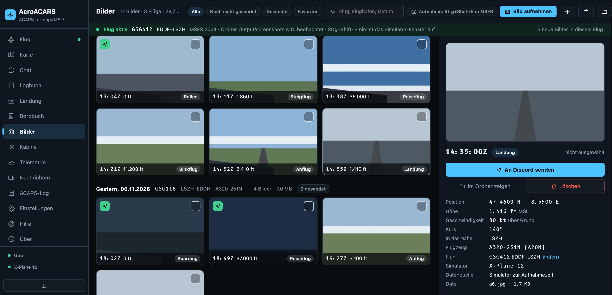
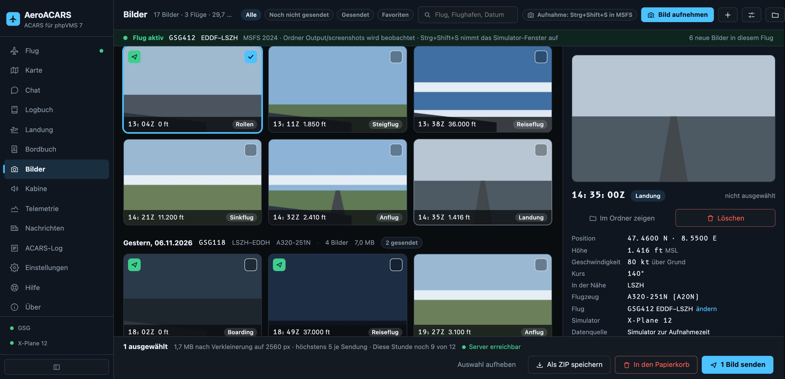
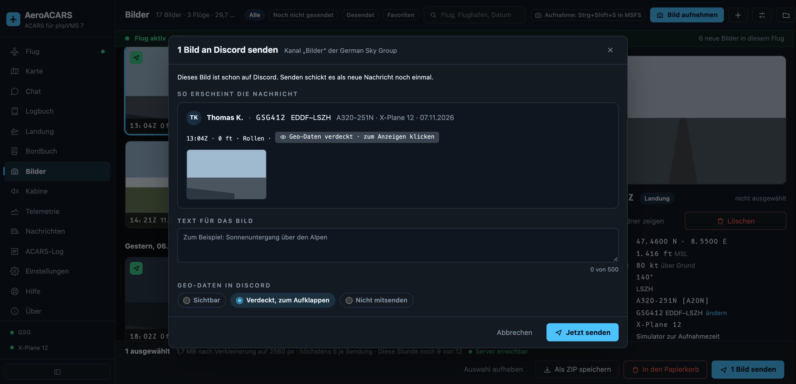
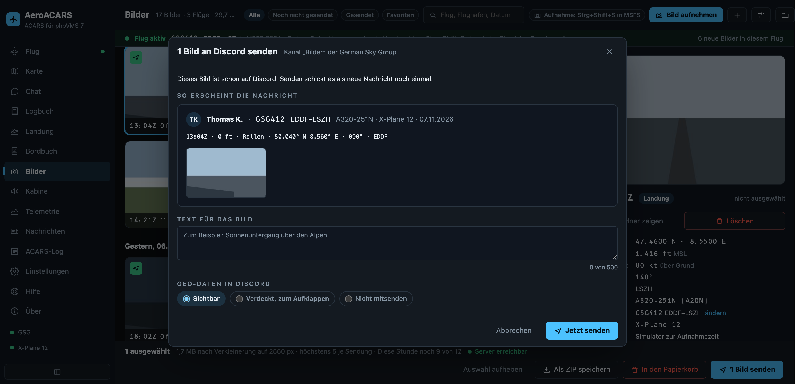
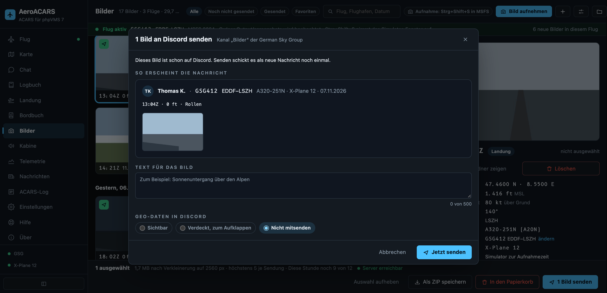
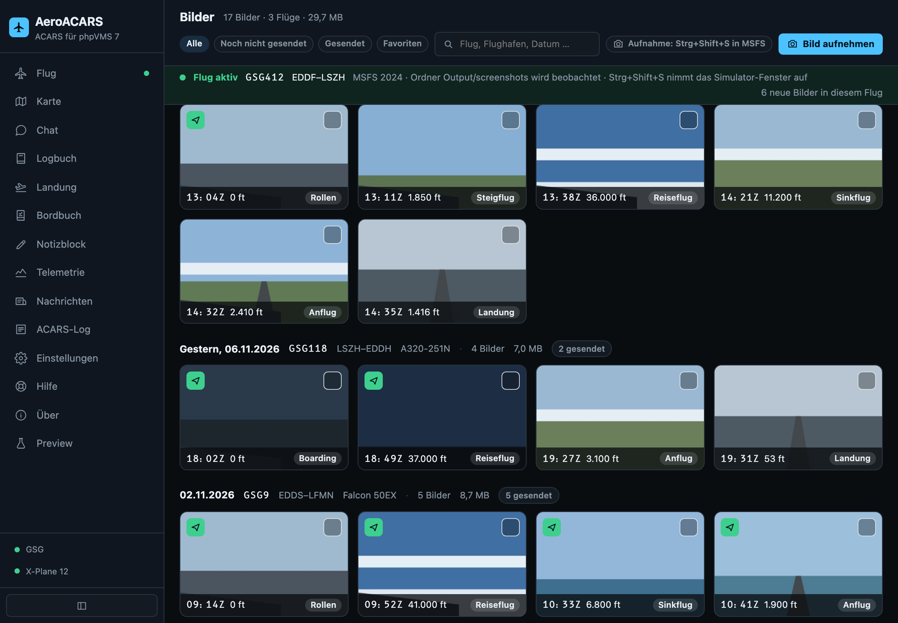

# Bilder-Tab: Stand vor dem Build (07.11.2026)

Browser-Vorschau mit Testdaten, kein echter Client.

## Hauptansicht, breitere rechte Spalte

## Auswahl: Senden nur noch unten

## Senden: verdeckt

## Senden: sichtbar

## Senden: nicht mitsenden

## Tablet

